<div align="center">

<picture>
  <source media="(prefers-color-scheme: dark)" srcset="assets/hero-dark.svg">
  <source media="(prefers-color-scheme: light)" srcset="assets/hero-light.svg">
  
</picture>

[](https://x.com/zkasuran)
[](https://t.me/zkasuran)
[](https://discord.com/users/zkasuran)
[](mailto:zkasuran@gmail.com)

</div>

I build agent tooling and developer infrastructure, mostly in the open. Quantum open source,
onchain agents, CI tooling, language runtimes. I work AI-assisted and build the tooling for it,
disclosed wherever a project asks.

### Results

| | Program | Result |
| :-- | :-- | :-- |
| 🥇 | **unitaryHACK 2026**, Unitary Foundation | Ranked **#1**. Six merged PRs across six quantum projects, $745 in bounties. |
| 🥇 | **Telegraph Hackathon Season I** | **1st** in the scorers track with [telegraph-salience-scorer](https://github.com/zkasuran/telegraph-salience-scorer), a from-scratch no_std Rust and WebAssembly module the node runs to rank oracle miners across Telegraph's canonical intents on Base Sepolia. |
| 🥇 | **Weekend Challenge: Generosity Edition**, DEV | Overall winner with [Keepalive](https://github.com/zkasuran/keepalive), which computes months of cash runway for 579,178 US nonprofits straight off their IRS filings and ranks where a gift buys the most time. DEV++ and a winner badge. [live](https://keepalive.zkasuran.dev) |
| 🥇 | **MiniMaxathon**, MiniMax x GMI Cloud | Won the Multimodality track with [Overhear](https://github.com/zkasuran/overhear), a topic to two-host audio episode generator. $500 cash, three months of MiniMax Max and $200 in GMI credits. |
| 🥇 | **Bug Smash**, DEV x Sentry | Won **Best Use of Sentry** for a real telemetry bug in Sentry's own Python SDK ([writeup](https://dev.to/zkasuran/sentrys-trace-said-gemini-flash-latest-google-served-gemini-36-flash-2j7a)). $500 and a limited-edition Sentry skateboard. |
| 🥈 | **Tiun x Microlaunch** | **2nd** with [Margyn](https://github.com/zkasuran/margyn), a test-suite auditor that scores your tests instead of your code. $1,500. |
| 🥉 | **Ready, Spec, Ship**, Kiro | 3rd with [testrazor](https://github.com/zkasuran/testrazor), a change-aware CI test gate. A one-year Kiro Pro Max subscription, worth $1,000. |

I am a GMI Cloud Clouder (community ambassador). My projects for GMI are community built and are not official GMI Cloud products.

### Featured work

**[gmi](https://github.com/zkasuran/gmi)** · [release 1.0.1](https://github.com/zkasuran/gmi/releases/tag/v1.0.1) · [official GMI posts](https://github.com/zkasuran/gmi#built-in-public-with-gmi-cloud)<br>
A community command line for GMI Cloud, built in public during a six-day takeover of GMI's official X account. It chats with any model GMI serves and generates images and video. It has a command for each of the 93 GMI API operations plus sandboxes. It also runs an MCP server that lets agents use GMI as tools. One-line install, Apache-2.0, 300 offline tests, four outside pull requests with two merged.

### Stack

`Python` `TypeScript` `JavaScript` `Rust` `Solidity` · `Node` `React` `FastAPI` `Docker` · `pytest` `Playwright` `GitHub Actions`

<div align="center">


</div>

### Support the work

Everything here is open source and free. If something saved you time, a tip keeps the lights on.

**EVM** (Ethereum, Base, Monad, any EVM L2)

```
0x6aAF38274063233044095F27392BCD41aF3921f7
```

**Solana**

```
9HwLcjYeN2gPjRGwD98pyaXtoWkbgKqvPrHuAkMvtCx5
```

Check the address in your wallet before sending. Never send to a chain the address does not support.
